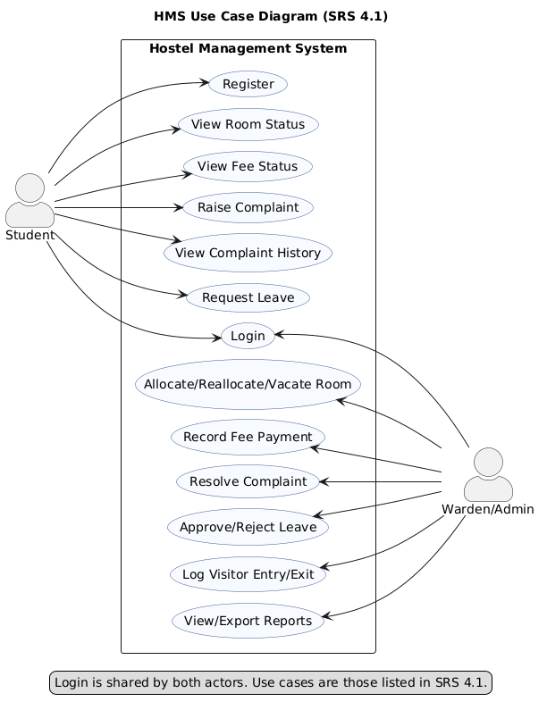
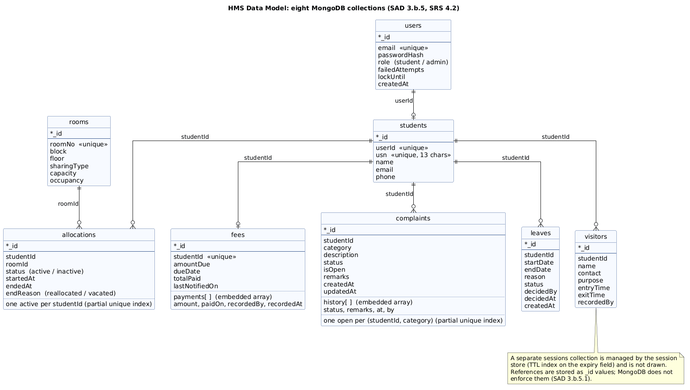

# Hostel Management System (HMS)

A Software Engineering mini-project by **Team 3, Class 5-J, PES University, Bangalore**.

HMS replaces register- and spreadsheet-based hostel record keeping with a centralized web application. Students can register, log in, view their room and fee status, raise complaints and request leave. Wardens/admins manage room allocation, fees, complaints, leave approvals, visitor entries, the dashboard and reports.

> **Important:** The submitted SRS, Software Architecture & Design Specification (SAD) and Test Plan are the baseline for implementation. Any deviation from them must be recorded in `docs/DEVIATIONS.md` and explained during the final demo.

*Last updated: 18 October 2026*

---

## Seed data for development and testing

The project includes a repeatable seed script for local development and demo testing.

- Run from the backend folder: `npm run seed`
- The script creates one admin account and 20 synthetic student accounts.
- This data is for test/demo use only and does not contain real student information.
- Passwords are stored as bcrypt hashes in MongoDB and are never committed as plaintext.

### Seeded test credentials

- Admin login: `admin@pes.edu` / `Admin@123`
- Student login pattern: `student001@pes.edu` to `student020@pes.edu` / `Pass@123`

These credentials are intended only for local testing and demo use. They are documented here so the test data remains explicit but not hidden in code.

### Seeded room mix

The seed script creates rooms across blocks A, B and C with mixed capacities and sharing types, including:

- an empty room (`A-102`),
- a full room (`A-101`),
- a room with exactly one free bed (`A-103`),
- and mixed single/double/triple/quad rooms across the hostel blocks.

### Deviation note

The room codes used in the seed script are consistent with the project’s room mix requirement and are suitable for demo and test flows. They are intentionally chosen to satisfy the acceptance criteria for HMS-26 and the Test Plan’s room conventions, while keeping the seeded room set realistic and repeatable.

---

## Table of Contents

1. [Team and Responsibilities](#1-team-and-responsibilities)
2. [Schedule](#2-schedule)
3. [Scope at a Glance](#3-scope-at-a-glance)
4. [Technology Stack](#4-technology-stack)
5. [Repository Structure](#5-repository-structure)
6. [Getting Started](#6-getting-started)
7. [Environment Variables](#7-environment-variables)
8. [Backlog and Project Board](#8-backlog-and-project-board)
9. [Git and GitHub Workflow](#9-git-and-github-workflow)
10. [Essential Git Commands](#10-essential-git-commands)
11. [Definition of Done](#11-definition-of-done)
12. [Testing](#12-testing)
13. [Deviations from the Submitted Documents](#13-deviations-from-the-submitted-documents)
14. [Sprint Demo Videos](#14-sprint-demo-videos)
15. [Security and Repository Hygiene](#15-security-and-repository-hygiene)
16. [Project Documentation](#16-project-documentation)

---

## 1. Team and Responsibilities

| Team member | Project role | Primary responsibilities |
| --- | --- | --- |
| **Chiranthan Sathrasala** | Project Manager / Repository Owner | Project board, backlog and story points, merge coordination, `DEVIATIONS.md`, submission |
| **Harsh M** | Technical Lead | Technology decisions (ADR-001), CI workflow (GitHub Actions), SAD, technical coordination |
| **Raiesh Giriyapanavar** | QA Lead | Test Plan, test execution, bug issues, recording actual results and Pass/Fail |
| **Neha K S** | Documentation and Demo Lead | SRS, UML/ER diagrams, Requirements Traceability Matrix (RTM), final documentation |

**Shared responsibilities:** everyone writes code, reviews pull requests, tests, integrates and fixes defects. Story points are split roughly equally across the four members. These are project roles; GitHub permissions are managed separately by the repository administrators.

---

## 2. Schedule

The schedule follows the professor's *Mini-Project Deliverables Part-2*.

| Dates (2026) | Phase | What happens |
| --- | --- | --- |
| 12 – 16 Oct | Dry run (practice) | Create the backlog, story points and assignees; set up the repo, scaffold, CI, seed data and the API contract; practise the PR workflow |
| 19 Oct | Backlog checkpoint | Last day to change entries in the backlog |
| 19 – 23 Oct | **Sprint 1** | Complete the Sprint 1 stories, enable GitHub Actions, deliver a working product, upload a **1-minute** demo video |
| 26 – 30 Oct | **Sprint 2** | Complete the Sprint 2 stories, a **2-minute** working-product demo video, complete the documentation, **freeze development** |

Use the GitHub Project board as the source of truth for backlog items, assignees, story points, status and sprint.

---

## 3. Scope at a Glance

| ID | Feature |
| --- | --- |
| FR-001 | Student registration and login (USN/email uniqueness, 5-failure / 15-minute lockout) |
| FR-002 | Room allocation: availability filters, allocate, reallocate, vacate, capacity and one-active-allocation rules |
| FR-003 | Fee tracking: due, paid, balance, status (Paid / Partially Paid / Due), optional due-date notification |
| FR-004 | Complaints: one open complaint per category, admin status and remarks, history with timestamps |
| FR-005 | Leave requests, visitor entry/exit log, admin dashboard, reports exported as **CSV and PDF** |
| NFR-001 | Standard pages load within 3 seconds; at least 200 concurrent users under normal load |
| NFR-002 | Password hashing, role-based access control, 30-minute inactivity session expiry |

**User roles:** Student and Warden/Admin. A separate System Administrator role and a separate security-guard role are out of scope for the demo (see Section 13).


### Diagrams

The UML use-case diagram and the data model (collection) diagram are in [`docs/diagrams/`](docs/diagrams/). Each has its PlantUML source (`.puml`) and is exported as SVG and PNG.

| Diagram | Shows | Files |
| --- | --- | --- |
| Use-case diagram (SRS 4.1) | Actors Student and Warden/Admin and their use cases | [PNG](docs/diagrams/use-case.png), [SVG](docs/diagrams/use-case.svg), [source](docs/diagrams/use-case.puml) |
| Data model (SRS 4.2, SAD 3.b.5) | Eight MongoDB collections, references by `_id`, embedded arrays (`payments`, `history`) | [PNG](docs/diagrams/er-collections.png), [SVG](docs/diagrams/er-collections.svg), [source](docs/diagrams/er-collections.puml) |





To regenerate the exports after editing a source (needs Java and Graphviz; GitHub does not render `.puml` files itself):

```bash
java -jar plantuml.jar -tsvg docs/diagrams/*.puml
java -jar plantuml.jar -tpng docs/diagrams/*.puml
```

---

## 4. Technology Stack

The professor requires the **MERN stack**.

| Layer | Technology |
| --- | --- |
| Frontend | React |
| Backend | Node.js with Express (REST APIs, JSON) |
| Database | MongoDB, accessed through Mongoose |
| CI | GitHub Actions (added in story HMS-25): lint, tests and frontend build on every PR |

The technology decision and its reasons are recorded in `docs/ADR-001.md`. The SRS and SAD describe a "relational database"; using MongoDB instead is a deviation and is logged in `docs/DEVIATIONS.md` (see Section 13).

### 4.1 Data integrity rules (MongoDB)

MongoDB does not enforce foreign keys or CHECK constraints, so the rules the SRS requires are enforced as follows:

- **Unique USN and email:** unique indexes on both fields (FR-001.2).
- **One active allocation per student:** a partial unique index on the allocation's student where its status is active (FR-002.4).
- **Room occupancy never exceeds capacity:** occupancy changes only through one atomic conditional update (increment only when occupancy is below capacity), so two simultaneous requests for the last bed cannot both succeed (FR-002.3).
- **Allocation, reallocation and vacate** are implemented in one service function each, so occupancy and allocation records always change together.
- **Fee status** is derived from the due and paid amounts, never entered by hand; overpayments are rejected.
- **Consistency check:** a small script compares each room's occupancy with its count of active allocations and is used in tests.
- Multi-document transactions are optional. They need a replica set (MongoDB Atlas provides one; a plain local install does not), so the code must not depend on them.

---

## 5. Repository Structure

```text
.
├── .github/
│   ├── workflows/            # GitHub Actions CI workflows
│   ├── ISSUE_TEMPLATE/       # Issue templates (story, bug report)
│   └── PULL_REQUEST_TEMPLATE.md
├── backend/                  # Node.js + Express API (src/, test/)
├── frontend/                 # React + Vite application (src/)
├── docs/
│   ├── baseline/             # Submitted v1.0 documents, never edited
│   ├── SRS.md                # v1.1
│   ├── SAD.md                # v1.1
│   ├── TEST_PLAN.md          # v1.1
│   ├── COMMIT_PLAN.md        # Day-by-day schedule, owners, reviewers
│   ├── DEVIATIONS.md         # Differences from the submitted documents
│   ├── ADR-001.md            # Technology decision
│   ├── API_CONTRACT.md       # Agreed endpoints
│   ├── RTM.md                # Requirements traceability matrix
│   ├── SETUP-HMS-01.md       # Windows setup walkthrough
│   └── diagrams/             # UML use-case and ER diagrams
├── videos/                   # Sprint demo videos
└── README.md
```

Some files are added by later stories (ADR-001 and API_CONTRACT by HMS-30, diagrams by HMS-31, RTM by HMS-23). Section 16 shows which are in the repository now.

Keep the originally submitted v1.0 documents in `docs/baseline/`. Any revised version must be clearly distinguishable; do not silently overwrite the submitted baseline.
---

## 6. Getting Started

**Prerequisites**

- Git
- Node.js 20 or newer and npm (CI uses Node 22)
- MongoDB Atlas: the team uses MongoDB Atlas, so MongoDB is **not** run locally and nothing needs to be installed (CI tests against MongoDB 7)
- (Optional) MongoDB Compass, to inspect collections

**Setup**

```bash
# 1. Clone and enter the repository
git clone <repository-url>
cd <repository-folder>

# 2. Configure environment variables (see Section 7)
cp backend/.env.example backend/.env          # macOS / Linux
# copy backend\.env.example backend\.env       (Windows Command Prompt)
# edit backend/.env with your own values; never commit it

# 3. Install and start the backend
cd backend
npm install
npm run dev
```

`backend/.env.example` still contains local MongoDB addresses. Set `MONGODB_URI` and `MONGODB_URI_TEST` in `backend/.env` to your Atlas connection strings (database names `hms` and `hms_test`) **before** starting the backend or running the tests.

Open `http://localhost:5000/health`. A healthy response is HTTP 200 with `status: "ok"` and `database: "connected"`.

```bash
# 4. In a second terminal, install and start the frontend
cd frontend
npm install
npm run dev
```

Open the URL printed by Vite (normally `http://localhost:5173`). If your API runs on another URL, copy `frontend/.env.example` to `frontend/.env` and set `VITE_API_BASE_URL`.

**Scripts**

| Folder | Command | What it does |
| --- | --- | --- |
| `backend` | `npm run dev` | Start the API with auto-restart |
| `backend` | `npm start` | Start the API once |
| `backend` | `npm test` | Run the backend tests (needs `MONGODB_URI_TEST`, see Section 7) |
| `backend` | `npm run lint` | Run ESLint |
| `backend` | `npm run check` | Syntax-check the source files |
| `frontend` | `npm run dev` | Start the Vite dev server |
| `frontend` | `npm test` | Run the frontend tests (Vitest) |
| `frontend` | `npm run lint` | Run ESLint |
| `frontend` | `npm run build` | Build for production |

**Troubleshooting**

- `connect ECONNREFUSED 127.0.0.1:27017` at start-up: `backend/.env` still has the local default. Put your Atlas connection string in the `MONGODB_URI` line.
- `Set MONGODB_URI_TEST to a database whose name ends in _test` from `npm test`: `backend/.env` is missing or that line is empty.

**Seed data:** `npm run seed` (run from `backend`) creates sample data for development and demos. The test accounts and rooms are listed in [Seed data for development and testing](#seed-data-for-development-and-testing) at the top of this README. They are test data, never real student information.

A Windows walkthrough is in [`docs/SETUP-HMS-01.md`](docs/SETUP-HMS-01.md).
---

## 7. Environment Variables

Copy `backend/.env.example` to `backend/.env`. Only placeholders belong in `.env.example`.

| Variable | Purpose | Default / example |
| --- | --- | --- |
| `NODE_ENV` | Runtime mode | `development` |
| `PORT` | API port | `5000` |
| `MONGODB_URI` | MongoDB Atlas connection string | `mongodb+srv://<db_user>:<db_password>@<cluster-host>/hms?retryWrites=true&w=majority` (placeholder; never commit a real connection string) |
| `MONGODB_URI_TEST` | Separate database for the automated tests. Its name must end in `_test`; the tests delete all data in it | `mongodb+srv://<db_user>:<db_password>@<cluster-host>/hms_test?retryWrites=true&w=majority` (placeholder; never point it at the `hms` database) |
| `SESSION_SECRET` | Secret used to sign sessions | long random placeholder |
| `SESSION_TIMEOUT_MINUTES` | Inactivity timeout (NFR-002) | `30` |
| `MAX_FAILED_LOGINS` | Failed attempts before lockout (FR-001.3) | `5` |
| `LOCKOUT_MINUTES` | Lockout duration (FR-001.3) | `15` |
| `SMTP_HOST`, `SMTP_PORT`, `SMTP_USER`, `SMTP_PASS` | Optional fee-notification email (FR-003.3) | empty / test SMTP account |

For testing, `SESSION_TIMEOUT_MINUTES` and `LOCKOUT_MINUTES` can be set to `1` so that lockout and session-expiry tests do not require waiting 15 or 30 minutes. The defaults must stay 30 and 15.

---

## 8. Backlog and Project Board

- The backlog lives in the GitHub Project **HMS Mini-Project**, linked to this repository. Every story is a GitHub Issue titled `[HMS-nn] Title`.
- Board fields: **Status** (Backlog, Ready, In progress, In review, Done), **Priority**, **Story Points** (1, 2, 3, 5, 8), **Sprint** (Dry Run, Sprint 1, Sprint 2) and **Epic**.
- Each story is a **vertical slice**: API, UI and tests, delivered by one owner.
- Every issue references its SRS requirement IDs and test case IDs.
- Every implementation task has an issue. Branches, commits and PRs refer to the **GitHub issue number** (`#n`), which appears next to the `[HMS-nn]` title.

---

## 9. Git and GitHub Workflow

### 9.1 The `main` branch is protected

- `main` is the shared, stable branch. **Never work or push directly on `main`.**
- Every change is made on a separate branch and reaches `main` only through a Pull Request (PR).
- A PR needs approval from **at least one teammate other than its author**.
- **The author must not review, approve or merge their own PR.**
- **Any teammate other than the author may review and merge** an approved PR whose checks pass.
- Fresh commits after an approval require a new approval.
- Resolve all review conversations before merging.
- Required CI checks must pass before merging once the GitHub Actions workflow (HMS-25) is in place.
- Do not bypass branch protection to save time.

> GitHub stops an author from approving their own PR, but it cannot stop them from pressing *Merge* after someone else approves. The "merger is not the author" rule is therefore a **team rule**: tick the PR-template checkbox and follow it.

### 9.2 Reviewer assignment

To spread the review load, the default reviewer is:

| PR author | Default reviewer |
| --- | --- |
| Chiranthan | Harsh |
| Harsh | Raiesh |
| Raiesh | Neha |
| Neha | Chiranthan |

If the default reviewer is unavailable, any other teammate who did not author the PR may review it. Review within 12 hours where possible.

### 9.3 Branch naming

One branch per issue or logically separate task, in lowercase with hyphens:

```text
feature/<issue-number>-short-description
fix/<issue-number>-short-description
docs/<issue-number>-short-description
test/<issue-number>-short-description
chore/<issue-number>-short-description
```

Examples (replace the numbers with real issue numbers):

```text
feature/12-user-registration
feature/18-room-allocation
fix/24-fee-balance-validation
docs/31-update-test-plan
test/35-room-capacity-tests
chore/7-configure-ci
```

### 9.4 Commit messages

Small, meaningful commits, at least one per working day, in this format:

```text
type(#issue-number): short description
```

```text
feat(#12): add student registration endpoint
fix(#24): reject negative fee payments
test(#35): add room capacity validation tests
docs(#31): update test plan traceability
chore(#7): configure GitHub Actions
```

Types: `feat`, `fix`, `test`, `docs`, `refactor`, `chore`.

### 9.5 Pull request checklist

- Title is clear; description includes `Closes #<issue-number>`.
- Lists the SRS requirement IDs and test case IDs covered.
- Relevant tests were actually run; do not claim tests passed unless they did.
- No secrets, `.env` files or unrelated files are included.
- Any deviation from the submitted documents is added to `docs/DEVIATIONS.md`.
- The author is not the merger.

Example PR description:

```markdown
## Summary
- Implemented student registration validation.

## Traceability
- SRS requirement: FR-001.1, FR-001.2
- Test cases: UT-01 to UT-05

## Verification
- [ ] Relevant tests run
- [ ] CI checks pass
- [ ] No secrets or unrelated files included
- [ ] I am not merging my own PR

Closes #12
```

---

## 10. Essential Git Commands

Run these in a terminal opened in your local project folder. Replace example names with your own.

### 10.1 Clone (first-time setup)

```bash
git clone <repository-url>
cd <repository-folder>
git remote -v
git status
```

### 10.2 Start a task from the latest `main`

```bash
git switch main
git pull origin main
git switch -c feature/12-user-registration
```

`-c` creates the branch and switches to it. Do not branch from an old or unrelated feature branch.

### 10.3 Check your branch before changing anything

```bash
git branch --show-current
git status
```

The branch name must be your task branch, **not `main`**.

### 10.4 Stage and commit

```bash
git status
git diff
git add path/to/file          # preferred: stage specific files
git add .                     # or stage all intended changes
git commit -m "feat(#12): add student registration endpoint"
```

### 10.5 Push to the correct remote branch

```bash
git push -u origin feature/12-user-registration   # first push of a new branch
git push                                          # later pushes
```

Check the branch name first with `git branch --show-current`.

### 10.6 Keep your branch up to date with `main`

```bash
git fetch origin
git switch main
git pull origin main
git switch feature/12-user-registration
git merge main
```

Resolve conflicts carefully, then:

```bash
git add <resolved-file>
git commit
git push
```

Do not force-push shared branches without coordinating with the team.

### 10.7 Open a pull request

1. On GitHub, go to **Pull requests → New pull request**.
2. Set **base** to `main` and **compare** to your branch.
3. Review the changed files, then fill in the PR description (Section 9.5).
4. Request a reviewer (Section 9.2).
5. Make requested changes on the same branch, commit and push; the PR updates automatically.
6. After approval and passing checks, a teammate who is not the author merges.

### 10.8 Delete a branch after its PR is merged

```bash
git switch main
git pull origin main
git branch -d feature/12-user-registration
git push origin --delete feature/12-user-registration
```

GitHub's *Delete branch* button removes only the remote branch. Use `git branch -D` only for an unmerged local branch you are sure you no longer need.

### 10.9 Everyday commands

```bash
git status                   # working-tree state
git branch                   # local branches
git branch -a                # local and remote branches
git fetch origin             # fetch remote updates
git pull origin main         # update local main
git diff                     # unstaged changes
git diff --staged            # staged changes
git log --oneline -10        # last 10 commits
git stash                    # save uncommitted changes temporarily
git stash pop                # restore them
```

Avoid `git reset --hard` and force-push unless you understand the consequences.

---

## 11. Definition of Done

A story is done only when all applicable items are true:

- [ ] It maps to a GitHub Issue and an agreed requirement or documentation task.
- [ ] The work is on a task-specific branch.
- [ ] Acceptance criteria are met and relevant tests are run, with results recorded.
- [ ] The PR targets `main`, references the issue and lists SRS and test case IDs.
- [ ] A teammate other than the author approved it, and required CI checks pass.
- [ ] A teammate other than the author merged it.
- [ ] Documentation and the RTM are updated where needed.
- [ ] Any deviation from the submitted SRS, SAD or Test Plan is in `docs/DEVIATIONS.md`.

---

## 12. Testing

- The Test Plan (`docs/TEST_PLAN.md`) defines Unit (UT), Integration (IT) and System (ST) test cases for FR-001 to FR-005 and the NFR checks.
- Record the **Actual Result** and **Test Result (Pass/Fail)** only **after** executing a test. Never mark an unexecuted test as passed.
- Log every failure as a GitHub Issue (label `bug`) and link it to the test case ID.
- Use test data only: the sample USNs in the seed data and dates relative to the day of execution.
- Automated tests run against a separate test database (or an in-memory MongoDB), never against development or demo data.
- Concurrency (room allocation) is tested with a script that sends two requests at the same time rather than by two people.
- Requirements that cannot be fully verified in a student environment (for example, 200 concurrent users) are reported honestly as *verified*, *failed*, *not tested* or *limited by environment*; never as passed without evidence.

---

## 13. Deviations from the Submitted Documents

Deviations are tracked in `docs/DEVIATIONS.md`, one entry per deviation: what changed, why, which document it affects, the impact and who approved it. They are explained during the final demo.

Deviations identified so far (to be confirmed as the implementation progresses):

- **USN format:** real USNs are 13 characters, while SRS Appendix B lists length 10.
- **Reallocate / vacate:** implemented as proposed FR-002.5 / FR-002.6 (present in the SRS overview, business rules and SAD, but without numbered FRs).
- **Fee model and endpoints:** a fee record with due amount and due date, plus an endpoint to create it; overpayments are rejected. No fee-record deletion feature.
- **Additional endpoints:** listing endpoints needed by the admin screens (students, complaints, leaves, visitors, current user) are defined in `docs/API_CONTRACT.md`.
- **Roles:** only Student and Warden/Admin; the System Administrator class and a separate security role are out of scope.
- **NFR test IDs:** NFR-001 / NFR-002 are verified through sub-checks (page load, 200 users, hashing, RBAC, session expiry).
- **Database:** MongoDB (from the professor's MERN stack) is used instead of the relational database in SRS 2.4, 3.2 and 7 and SAD 3.a.3, 3.a.6 and 3.b.5. Entities become collections; the integrity rules in Section 4.1 replace foreign keys and constraints. Story HMS-02 is read as "MongoDB data model, indexes and setup".
- **Process:** any teammate may review and merge, as long as they are not the PR author.

---

## 14. Sprint Demo Videos

| Video | Length | Content | Due |
| --- | --- | --- | --- |
| Sprint 1 | about 1 minute | Working product from Sprint 1 | end of Sprint 1 (23 Oct) |
| Sprint 2 | about 2 minutes | Completed working product | end of Sprint 2 (30 Oct) |

Rules:

- Show the **real running application**, not screenshots or mock screens.
- Save to `videos/`, for example `videos/sprint1-demo.mp4` and `videos/sprint2-demo.mp4`.
- **File-size limits:** GitHub's web upload accepts files up to **25 MB**, and a `git push` is **blocked above 100 MB** (a warning appears at 50 MB). Keep each video well under 25 MB so either method works.
- Record at 720p and compress before committing:

```bash
ffmpeg -i raw-recording.mp4 -vf scale=-2:720 -c:v libx264 -crf 28 -preset medium -c:a aac -b:a 96k sprint1-demo.mp4
```

- Do not commit the raw recording. Play the compressed file once to make sure it works before opening the PR.
- Mention the video file name and location in the sprint's PR or in `docs/`.

---

## 15. Security and Repository Hygiene

- Never commit `.env` files, passwords, API keys, database credentials, tokens or real student information.
- Commit `.env.example` with placeholders only, and keep local files out of Git with `.gitignore`.
- Never store plaintext passwords; the API must never return password hashes or internal errors to the browser.
- Use test data for development and demos.
- A student may only access their **own** data: server-side checks must compare the requested USN with the logged-in user, not just hide UI controls.
- Report an accidentally committed secret immediately. Deleting it in a later commit does not remove it from Git history, so rotate it.
- A daily MongoDB backup procedure (for example `mongodump`) is documented under story HMS-22. HTTPS applies wherever the app is deployed.

---

## 16. Project Documentation

Keep these in `docs/`:

| Document | File | Notes |
| --- | --- | --- |
| Software Requirements Specification (SRS) | [`docs/SRS.md`](docs/SRS.md) | v1.1; v1.0 kept in `docs/baseline/` |
| Software Architecture & Design Specification (SAD) | [`docs/SAD.md`](docs/SAD.md) | v1.1; v1.0 kept in `docs/baseline/` |
| Test Plan | [`docs/TEST_PLAN.md`](docs/TEST_PLAN.md) | v1.1 |
| Commit plan | [`docs/COMMIT_PLAN.md`](docs/COMMIT_PLAN.md) | Schedule, owners, reviewers |
| Deviations | [`docs/DEVIATIONS.md`](docs/DEVIATIONS.md) | Every difference from the submitted documents |
| ADR-001 | [`docs/ADR-001.md`](docs/ADR-001.md) | Technology decision |
| API contract | [`docs/API_CONTRACT.md`](docs/API_CONTRACT.md) | Agreed endpoints |
| Diagrams | [`docs/diagrams`](docs/diagrams) | UML use-case and ER diagrams |
| Requirements Traceability Matrix (RTM) | `docs/RTM.md` (pending HMS-23) | Requirement to test traceability |
| Baseline (submitted v1.0) | [`docs/baseline`](docs/baseline) | SRS and SAD v1.0, never edited |
| Setup guide | [`docs/SETUP-HMS-01.md`](docs/SETUP-HMS-01.md) | Windows walkthrough |
---

**Team:** Team 3, Class 5-J
**Project:** Hostel Management System
**Project Manager:** Chiranthan Sathrasala