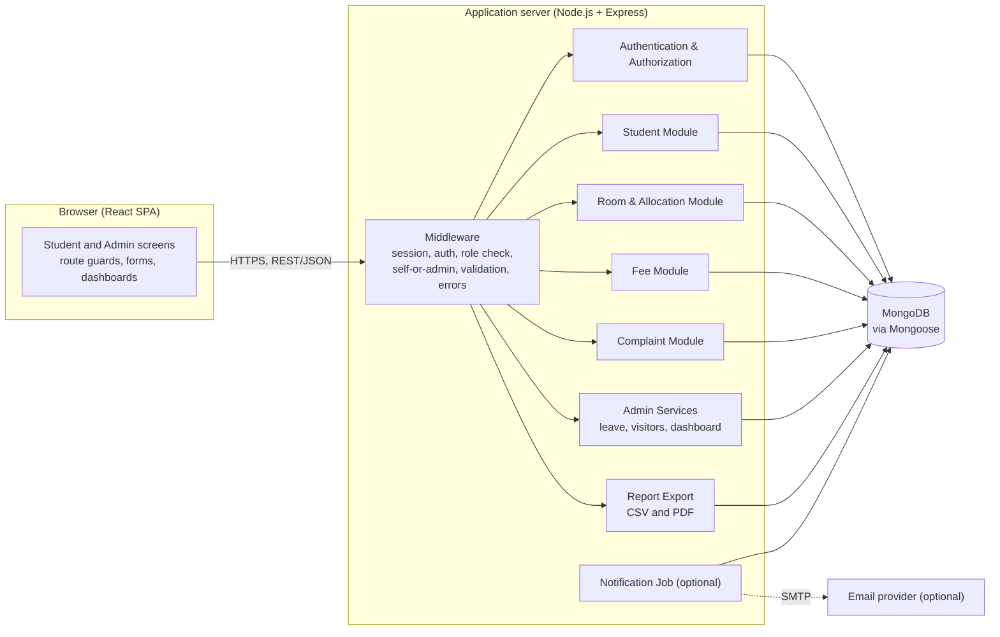
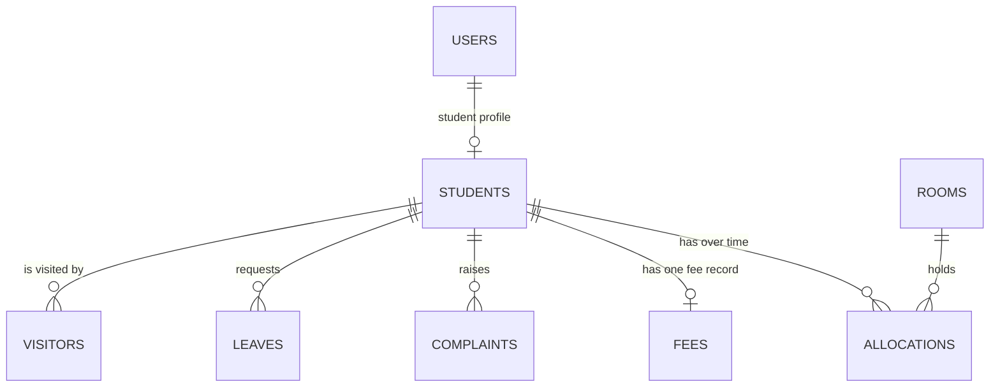
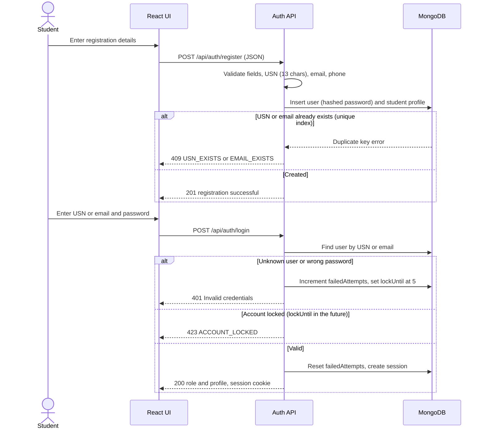
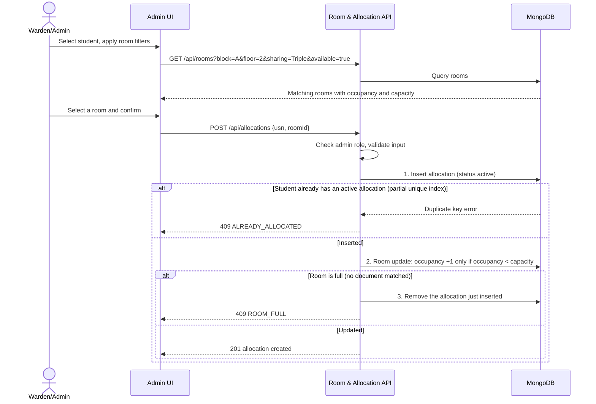

**PES UNIVERSITY, BANGALORE**

**SOFTWARE ARCHITECTURE & DESIGN SPECIFICATION**

for

**HOSTEL MANAGEMENT SYSTEM**

Version 1.1

**Team 3 — 5-J**

| **USN** | **Team Member** |
| --- | --- |
| PES1UG24CS924 | Raiesh Giriyapanavar |
| PES1UG24CS565 | Chiranthan Sathrasala |
| PES1UG24CS581 | Neha K S |
| PES1UG24CS573 | Harsh M |

Reference: Hostel Management System SRS v1.1 (14 October 2026); SRS v1.0 (06 September 2026) is the submitted baseline

Prepared by Harsh M (v1.0); revised by Team 3 (v1.1), for Software Engineering Mini-Project Evaluation

# Document Control

| **Item** | **Details** |
| --- | --- |
| Document | Software Architecture & Design Specification |
| System | Hostel Management System (HMS) |
| Version | 1.1 |
| Base Requirements | HMS SRS v1.1 dated 14-Oct-2026 |
| Related Verification Document | HMS Test Plan v1.1 (14-Oct-2026) |
| Team | Team 3, Class 5-J |
| Preparation Date | 14-Oct-2026 |
| Baseline | SAD v1.0 (02-Oct-2026) is retained unchanged as the submitted baseline. Differences are recorded in `docs/DEVIATIONS.md`. |

## Revision History

| **Name** | **Date** | **Reason For Changes** | **Version** |
| --- | --- | --- | --- |
| Team 3 | 02-Oct-2026 | Initial architecture and design specification based on SRS v1.0 | 1.0 |
| Team 3 | 14-Oct-2026 | Revision for the MERN stack (MongoDB), new requirements FR-002.5, FR-002.6, FR-003.4 and NFR sub-requirements, completed API contract, collection design with integrity rules, traceability to Test Plan v1.1 | 1.1 |

## Summary of Changes in v1.1

| # | Area | Change in v1.1 | Sections |
| --- | --- | --- | --- |
| 1 | Technology stack | The relational database is replaced by MongoDB with Mongoose (MERN stack required by the course). Technology choices are listed and the decision is recorded in `docs/ADR-001.md`. | 3.a.1, 3.a.2, 3.a.3, 3.a.6, 3.b.5 |
| 2 | Data integrity | Foreign keys, CHECK constraints and transactions are replaced by unique and partial unique indexes, atomic conditional updates, compensating steps, and a consistency-check script. | 3.a.6, 3.b.5, 3.b.5.1 |
| 3 | Requirements | The design realizes FR-002.5 (reallocate), FR-002.6 (vacate with confirmation), FR-003.4 (payment validation) and the NFR sub-requirements NFR-001.a/b and NFR-002.a/b/c. | 3.a.4 |
| 4 | API | The endpoint list is completed: the fee-due endpoint, list endpoints for the admin and student screens, the current-user endpoint, the vacate confirm flag, report formats, and the notification trigger. | 3.b.3 |
| 5 | Security | Students may read only their own records; lockout and session timeouts are configuration values with the stated defaults; session handling is specified. | 3.a.5 |
| 6 | Fee model | The fee entity is a fee record per student holding the amount due, due date and a payment list. Status and balance are derived. Fee-record deletion is removed. | 3.a.6, 3.b.5 |
| 7 | Roles | Student and Warden/Admin only. Admin accounts are created by the seed script. | 3.a.1, 3.a.5 |
| 8 | USN | USN is 13 alphanumeric characters (for example PES1UG24CS924). | 3.b.4 |
| 9 | Diagrams | Figures are provided as Mermaid diagrams that render on GitHub. The formal UML and ER diagrams are kept in `docs/diagrams/`. | 3.a.1, 3.b.1, 3.b.2, 3.b.5 |
| 10 | Traceability | The matrix uses real requirement IDs and Test Plan v1.1 case IDs. | 3.a.4 |

# Contents

3. Software Architecture & Design Specification

3.a Architecture

- 3.a.1 Component Diagram and Description
- 3.a.2 Architectural Pattern
- 3.a.3 Architecture Decisions and Responsibilities
- 3.a.4 Traceability to Requirements
- 3.a.5 Security Architecture
- 3.a.6 Deployment and Data Architecture
- 3.a.7 Other Architecture Sections

3.b Design

- 3.b.1 UML Sequence Diagram — Student Registration and Login
- 3.b.2 UML Sequence Diagram — Room Allocation
- 3.b.3 API Design
- 3.b.4 Error Handling
- 3.b.5 Data and Component Design
- 3.b.6 Other Design Sections

# 3. Software Architecture & Design Specification

## 3.a Architecture

### 3.a.1 Component Diagram and Description

The architecture is a web-based three-layer system built on the MERN stack. The browser runs a React single-page application that provides the role-specific user interface. The application/API layer is a Node.js/Express server that implements authentication and the hostel business rules. MongoDB, accessed through Mongoose, provides persistent storage. The modules in the application layer are separated by responsibility so that requirements can be implemented and tested independently.



*Figure 1. Component-level architecture of the Hostel Management System.*

| **Component** | **Responsibility** | **Primary Requirements** |
| --- | --- | --- |
| Presentation Layer (React) | Student and admin screens, forms with validation feedback, dashboards, route guards by role, report download actions. Talks to the server only through the REST API. | FR-001 to FR-005, NFR-001 |
| Middleware | Session loading, authentication check, role check, self-or-admin check on `{usn}` routes, request validation, one central error handler returning the common JSON error format. | NFR-002 |
| Authentication & Authorization | Registration, login by USN or email, password hashing and verification, failed-login lockout, logout, current-user lookup, session expiry. | FR-001, NFR-002 |
| Student Module | Student profile and dashboard data (room, fee status, complaint and leave summary); student list for admin screens. | FR-001, FR-002, FR-003, FR-004, FR-005 |
| Room & Allocation Module | Room filtering, allocate, reallocate, vacate, capacity and one-active-allocation rules, occupancy updates. | FR-002.1 to FR-002.6 |
| Fee Module | Fee record (amount due and due date), payment recording, balance and derived status, payment validation. | FR-003.1, FR-003.2, FR-003.4 |
| Complaint Module | Complaint creation, one-open-per-category rule, status and remarks updates, history. | FR-004 |
| Admin Services | Leave decisions, visitor entry and exit, dashboard aggregation. | FR-005.1 to FR-005.4 |
| Report Export | Builds student, fee and complaint reports from one data function and renders them as CSV or PDF. | FR-005.5 |
| MongoDB | Collections: users, students, rooms, allocations, fees, complaints, leaves, visitors, and sessions. | All persistent requirements |
| Optional Notification Job | Finds fee records due within 7 days and sends email through a configured SMTP provider. | FR-003.3 |

### 3.a.2 Architectural Pattern

The architectural pattern is a layered, modular monolithic web application with a REST API. This suits the project because the SRS specifies a web front end, a back-end application server, a MongoDB database, and REST/JSON communication. The modules remain logically separate without the operational overhead of multiple independently deployed services.

| **Layer** | **Main Role** | **Design Rule** |
| --- | --- | --- |
| Presentation | Browser-based student and admin interfaces (React). | Never access the database directly; communicate only through the API. Hiding a control is never the access check. |
| Application / API | Business rules, authentication, authorization, validation, module workflows, response generation (Express). | Keep module responsibilities separate. Validate and authorize before any database change. Routes call services; services call models. |
| Data | Persistence (MongoDB through Mongoose). | Enforce integrity with indexes and atomic conditional updates (Section 3.b.5.1), not with application checks alone. |

Within the server each module has the same internal structure: **routes** (URL and middleware wiring), **controllers** (request/response handling), **services** (business rules), and **models** (Mongoose schemas and indexes). Business rules live only in services, so a rule is the same whether the request comes from the UI or directly from a tool such as Postman.

### 3.a.3 Architecture Decisions and Responsibilities

| **Decision** | **Rationale** | **Effect on System** |
| --- | --- | --- |
| MERN stack (React, Express, Node.js, MongoDB with Mongoose) | Required by the course; one language and JSON end to end, which matches the SRS REST/JSON requirement. | Uniform tooling; the same JSON shapes are used in the UI, API and database. |
| MongoDB instead of a relational database | Follows the MERN stack. This is a deviation from SRS v1.0 and SAD v1.0, approved by the professor and recorded in `docs/ADR-001.md` and `docs/DEVIATIONS.md`. | No foreign keys, CHECK constraints or mandatory transactions. Integrity rules are enforced with unique and partial unique indexes, atomic conditional updates and compensating steps (3.b.5.1). |
| REST API with JSON | Specified in the SRS software-interface requirements. | A consistent contract between browser and server, frozen in `docs/API_CONTRACT.md`. |
| Server-side sessions (express-session with a MongoDB session store, rolling cookie) | Fits the 30-minute inactivity requirement: every request extends the session, and the server can end it immediately. | The session cookie is HttpOnly and SameSite; no token is kept in browser storage. |
| Role-based access control | Students and Warden/Admin have different operations. | Role middleware on every protected route, plus a self-or-admin check on routes that carry a student's USN. |
| Modular application layer | Functional requirements divide into authentication, rooms, fees, complaints and admin services. | Simpler development, testing, maintenance and traceability. |
| Centralized validation and error handling | Rules must hold even when a request bypasses the UI. | One validation layer at the API boundary and one error handler. |
| Derived values are not stored | Fee status and balance, and room vacancy, are computed from stored facts. | Avoids values that disagree with each other. |

### 3.a.4 Traceability to Requirements

The matrix connects each SRS v1.1 requirement to the architecture area and design section that realize it, and to the test cases in Test Plan v1.1.

| **Req. ID** | **Requirement** | **Architecture Area** | **Design Section** | **Test Case IDs** |
| --- | --- | --- | --- | --- |
| FR-001.1 | Student registration with required details (USN 13 characters) | Authentication & Student Module | 3.b.1, 3.b.3, 3.b.4 | UT-01, UT-04, UT-05, UT-28, ST-06 |
| FR-001.2 | USN and email uniqueness | Authentication & Student Module | 3.b.4, 3.b.5.1 | UT-02, UT-03 |
| FR-001.3 | Login by USN or email; 15-minute lockout after 5 failures | Authentication & Authorization | 3.a.5, 3.b.1, 3.b.3, 3.b.4 | UT-06, UT-07, UT-29, UT-30, IT-01, IT-02, IT-12, IT-13, ST-06, NFR-05 |
| FR-002.1 | Room availability by block, floor, sharing type | Room & Allocation Module | 3.b.3, 3.b.5 | UT-08, UT-31 |
| FR-002.2 | Allocate a room and update occupancy | Room & Allocation Module | 3.b.2, 3.b.5.1 | UT-09, IT-16, ST-01 |
| FR-002.3 | Prevent allocation beyond capacity | Room & Allocation Module | 3.b.2, 3.b.4, 3.b.5.1 | UT-10, IT-14, ST-02 |
| FR-002.4 | One active allocation per student | Room & Allocation Module | 3.a.6, 3.b.5.1 | UT-11, IT-16 |
| FR-002.5 | Reallocate a student to another room | Room & Allocation Module | 3.b.3, 3.b.5.1 | IT-03, IT-14, IT-16 |
| FR-002.6 | Vacate a room after confirmation | Room & Allocation Module | 3.b.3, 3.b.5.1, 3.b.6 | IT-04, IT-15, IT-16 |
| FR-003.1 | Set fee due and due date; record payments and balance | Fee Module | 3.b.3, 3.b.5 | UT-32, UT-12, UT-13, ST-03 |
| FR-003.2 | Paid / Partially Paid / Due status | Fee Module | 3.b.3, 3.b.5 | UT-14, UT-15, IT-06 |
| FR-003.3 | Notify when due date is within 7 days, if enabled | Fee Module + Notification Job | 3.a.7, 3.b.6 | IT-07, IT-17 |
| FR-003.4 | Reject zero, negative or excessive payments | Fee Module | 3.b.4, 3.b.5.1 | UT-16, UT-33, UT-34 |
| FR-004.1 | At most one open complaint per category | Complaint Module | 3.b.4, 3.b.5.1 | UT-17, UT-18, UT-19, UT-35, IT-20 |
| FR-004.2 | Admin status and remarks updates | Complaint Module | 3.b.3, 3.b.4 | UT-20, UT-21, UT-36, UT-37, ST-04 |
| FR-004.3 | Complaint history with timestamps | Complaint Module | 3.b.3, 3.b.5 | IT-08, ST-04 |
| FR-005.1 | Leave request submission | Admin Services | 3.b.3, 3.b.4 | UT-22, UT-23, UT-38, ST-05 |
| FR-005.2 | Leave approval/rejection; student views status | Admin Services | 3.b.3, 3.b.5.1 | UT-24, UT-25, IT-22, ST-05 |
| FR-005.3 | Visitor entry and exit log (admin) | Admin Services | 3.b.3, 3.b.4 | UT-26, UT-27, UT-39, UT-40 |
| FR-005.4 | Dashboard: occupancy, vacancies, dues, open complaints | Admin Services | 3.a.7, 3.b.3 | IT-09 |
| FR-005.5 | Export reports as CSV and PDF | Report Export | 3.b.3, 3.b.6 | IT-10, IT-11, IT-21 |
| NFR-001.a | Standard page load within 3 seconds | Application Infrastructure | 3.a.7 | NFR-01 |
| NFR-001.b | At least 200 concurrent users | Application Infrastructure | 3.a.7 | NFR-04 |
| NFR-002.a | Password hashing | Authentication & Authorization | 3.a.5 | NFR-02 |
| NFR-002.b | Role-based access; students access only their own records | Authentication & Authorization | 3.a.5, 3.b.3 | IT-05, UT-21, IT-18, IT-19, IT-21 |
| NFR-002.c | Session expiry after 30 minutes of inactivity | Authentication & Authorization | 3.a.5 | NFR-03, NFR-05 |

### 3.a.5 Security Architecture

Security is a cross-cutting concern around authentication, authorization, session management, input validation and protected data access.

| **Security Control** | **Design** | **Requirement / Risk Addressed** |
| --- | --- | --- |
| Password storage | Passwords are hashed with bcrypt (cost factor 10 or higher) before storage. Plaintext passwords are never stored, logged or returned, and the hash is never included in an API response. | NFR-002.a |
| Authentication | Login accepts a USN or an email. If the identifier matches the 13-character USN pattern it is looked up as a USN, otherwise as an email. Valid credentials create a server-side session. | FR-001.3 |
| No account enumeration | An unknown user and a wrong password return the same status (401) and message ("Invalid credentials"). A dummy hash comparison is made for unknown users so that timing does not reveal the difference. | FR-001.3 (IT-13) |
| Login lockout | The user document keeps `failedAttempts` and `lockUntil`. A wrong password increments the counter atomically. When it reaches `MAX_FAILED_LOGINS` (default 5), `lockUntil` is set to now plus `LOCKOUT_MINUTES` (default 15). While `lockUntil` is in the future, login returns 423 even for a correct password. A successful login resets the counter. | FR-001.3 |
| Session management | express-session with a MongoDB session store. The cookie is HttpOnly, SameSite=Lax, and Secure when served over HTTPS. The session is rolling: each request renews it for `SESSION_TIMEOUT_MINUTES` (default 30). An expired or missing session returns 401 `SESSION_EXPIRED`. Logout destroys the server-side session. | NFR-002.c |
| Configurable security values | `MAX_FAILED_LOGINS`, `LOCKOUT_MINUTES` and `SESSION_TIMEOUT_MINUTES` come from environment variables with the defaults above. Test mode sets the two durations to 1 minute. | FR-001.3, NFR-002.c |
| Role-based authorization | The `requireRole('admin')` middleware protects every admin route. The role comes from the session, never from the request body. | NFR-002.b |
| Own-records rule | Routes with a student's USN, and routes that take a record ID (fee, complaint, leave), use the self-or-admin check: a student may access a record only when its owner is the logged-in student; otherwise 403. Lists for students are scoped by the session user (`/mine`). | NFR-002.b |
| Transport security | HTTPS between browser and server wherever the system is deployed (terminated by the hosting platform or a reverse proxy). Local development uses HTTP. | SRS Communications Interface |
| Input validation | Required fields, formats (USN, email, phone), date ranges, amounts, enumerations and identifiers are validated at the API boundary. Request bodies are rejected if they contain unexpected operator-like keys (for example keys starting with `$`), which protects Mongo queries from injection. | FR-001 to FR-005 |
| Protected critical actions | Vacating a room requires an explicit `confirm: true` in the request and a confirmation dialog in the UI. | FR-002.6 |
| CORS and cross-site requests | CORS allows only the configured front-end origin; cookies are SameSite; state-changing requests accept JSON only. | Cross-site request risk |
| Secrets | `SESSION_SECRET`, `MONGODB_URI` and SMTP credentials come from environment variables. `.env` is never committed; `.env.example` holds placeholders. | Operational security |
| Data protection | Hostel data is used only for administration, and access is restricted by role. | SRS Other Requirements |
| Backups | Daily database backup with `mongodump`; the restore procedure is documented and tested once. | SRS database requirement |

#### Security Request Flow

1. The browser sends an HTTPS request with the session cookie.
2. The session middleware loads the session; if it is missing or expired the API returns 401.
3. The role middleware checks that the role may call the route (403 otherwise).
4. For routes that carry a USN or record ID, the self-or-admin check confirms ownership.
5. The service validates the request data and the business rules before changing anything.
6. The database operation is executed (atomically where required).
7. The API returns the common JSON response without passwords, hashes, stack traces or database details.

### 3.a.6 Deployment and Data Architecture

The deployment model is a conventional client-server web deployment. Students and administrators use a supported browser. The Express server hosts the REST API and, in production, may also serve the built React files. MongoDB (a local server or MongoDB Atlas) is reachable only from the server and never from the browser.

| **Node / Store** | **Contents** | **Communication** |
| --- | --- | --- |
| Student/Admin Device | Browser, React SPA, session cookie. | HTTPS to the application server |
| Application Server | Express REST API, business modules, validation, report generation, notification job. | HTTPS from clients; MongoDB connection to the database |
| MongoDB | Collections users, students, rooms, allocations, fees, complaints, leaves, visitors, and sessions. | Private connection from the application server |
| Optional Email Provider | Email delivery when SMTP settings are configured (a test inbox such as Ethereal or Mailtrap is used in testing). | Server-side SMTP only |

The logical entities follow the SRS: User, Student, Room, Allocation, FeeRecord (with its payments), Complaint, LeaveRequest and Visitor. They are stored as collections that refer to each other by ID (Section 3.b.5). A student has allocation documents over time, and at most one of them is active. Room capacity is the upper bound on occupancy.



*Figure 2. Collections and references. The formal ER diagram with attributes is in `docs/diagrams/`.*

### 3.a.7 Other Architecture Sections

#### Scalability and Performance

NFR-001.a requires standard pages to load within 3 seconds, and NFR-001.b requires at least 200 concurrent users under normal load. The design supports this with:

- indexes on every field used for lookup or filtering (Section 3.b.5);
- list endpoints that return only the fields a screen needs, with a page-size limit;
- dashboard figures computed by one aggregation pipeline per figure group rather than by loading documents into the server;
- a bcrypt cost factor chosen so that login stays within the page-load target;
- a single connection pool shared by all requests;
- a minified React build.

The 200-user target is checked by a scripted load test (NFR-04, k6 or autocannon). Results and the limits of the test environment are reported as measured; the target is not claimed as met without evidence.

#### Reliability and Consistency

- Room occupancy changes only through an atomic conditional update, so it can never exceed capacity even under concurrent requests (Section 3.b.5.1).
- Each multi-step operation (allocate, reallocate, vacate, payment, registration) has a defined order and a compensating step, so a failure does not leave records half-updated.
- Fee status and balance are derived from the stored amount due and total paid, never typed in.
- Multi-document transactions are optional. They need a replica set (Atlas provides one; a plain local installation does not), so the code must work without them. Where a replica set is available, the same steps may be wrapped in a transaction.
- A consistency-check script compares every room's occupancy with its count of active allocations and reports any difference. It is used in testing (IT-16) and can be run after a crash.
- Daily `mongodump` backups.
- Errors return controlled responses and never expose internals.

#### Maintainability

Module boundaries align with the functional requirements and the test groups, giving a direct mapping between requirements, modules, endpoints, collections and test cases. Authentication and role-based access are isolated so that they can be reused in future projects, as requested in the SRS.

## 3.b Design

### 3.b.1 UML Sequence Diagram — Student Registration and Login

Registration and login share the authentication component. Registration creates the user and the student profile after validation. Login resolves the identifier, checks the lock, verifies the password, and creates a session.



*Figure 3. Sequence flow for student registration and login.*

#### Sequence Description

1. The student enters registration details in the web interface.
2. The interface sends a JSON request to `POST /api/auth/register` over HTTPS.
3. The API checks the mandatory fields and formats. The USN must be 13 alphanumeric characters; it is stored in upper case.
4. The API hashes the password and inserts the user and the student profile. A duplicate USN or email is detected by the unique indexes and returned as 409; if the second insert fails, the first is removed (compensating step) so no orphan account remains.
5. For login, the API resolves the identifier as a USN or an email, checks `lockUntil`, and verifies the password against the stored hash.
6. A failed attempt increments `failedAttempts`; on the fifth consecutive failure `lockUntil` is set. A locked account is rejected with 423 even if the password is correct.
7. A successful login resets the counter, creates a server-side session and returns the role and profile. The student dashboard is then shown.
8. Logout destroys the session. `GET /api/auth/me` returns the current user or 401.

### 3.b.2 UML Sequence Diagram — Room Allocation

The allocation enforces the two business constraints: the student has no other active allocation, and the room has capacity. Both are enforced by the database, not only by application checks.



*Figure 4. Sequence flow for Warden/Admin room allocation.*

#### Sequence Description

1. The Warden/Admin selects a registered student and requests rooms matching the block, floor and sharing filters.
2. The API returns each matching room with its capacity, occupancy and vacancy.
3. On confirmation the API checks the role and validates the input.
4. The API inserts an allocation document with status `active`. The partial unique index on the student rejects it if the student already has an active allocation (409 `ALREADY_ALLOCATED`).
5. The API then increments the room's occupancy with a single conditional update that matches only when `occupancy < capacity`. If no document matches, the room is full: the new allocation is removed and the API returns 409 `ROOM_FULL`. Two simultaneous requests for the last bed cannot both succeed, because only one conditional update can match (ST-02).
6. The created allocation is returned, and the student's dashboard shows the new room.

### 3.b.3 API Design

The SRS specifies REST APIs with JSON request and response data. This table is the design contract; the same list is frozen in `docs/API_CONTRACT.md`. All routes except register and login require a valid session.

| **Method** | **Endpoint** | **Role** | **Purpose** | **Typical Status** |
| --- | --- | --- | --- | --- |
| POST | /api/auth/register | Public | Register a student account. | 201 / 400 / 409 |
| POST | /api/auth/login | Public | Authenticate a student or admin by USN or email and start a session. | 200 / 400 / 401 / 423 |
| POST | /api/auth/logout | Authenticated | End the current session. | 200 / 401 |
| GET | /api/auth/me | Authenticated | Return the current user (role, USN, name). | 200 / 401 |
| GET | /api/students | Admin | List students; filters: `unallocated=true`, `search`. | 200 / 401 / 403 |
| GET | /api/students/{usn}/dashboard | Student (own) / Admin | Room, fee, complaint and leave summary. | 200 / 401 / 403 / 404 |
| GET | /api/rooms | Admin | List rooms; filters: `block`, `floor`, `sharing`, `available`. | 200 / 400 / 401 / 403 |
| GET | /api/allocations | Admin | List allocations; filters: `active`, `usn`, `roomId`. | 200 / 401 / 403 |
| POST | /api/allocations | Admin | Create an active allocation after validation. | 201 / 400 / 403 / 404 / 409 |
| PUT | /api/allocations/{id}/reallocate | Admin | Move a student to another room (body: `roomId`). | 200 / 400 / 403 / 404 / 409 |
| POST | /api/allocations/{id}/vacate | Admin | Deactivate an allocation and release occupancy (body: `confirm: true`). | 200 / 400 / 403 / 404 |
| POST | /api/fees | Admin | Create the fee record: amount due and due date. | 201 / 400 / 403 / 404 / 409 |
| POST | /api/fees/payments | Admin | Record a payment (body: `usn`, `amount`, `paidOn`). | 201 / 400 / 403 / 404 |
| GET | /api/fees | Admin | List fee records with balance and status; filter: `status`. | 200 / 401 / 403 |
| GET | /api/fees/{usn} | Student (own) / Admin | Fee status, balance and payment history. | 200 / 401 / 403 / 404 |
| POST | /api/complaints | Student | Create a complaint (category, description). | 201 / 400 / 409 |
| GET | /api/complaints/mine | Student | The logged-in student's complaint history. | 200 / 401 |
| GET | /api/complaints | Admin | List complaints; filters: `status`, `category`. | 200 / 401 / 403 |
| GET | /api/complaints/{id} | Owner / Admin | One complaint with its history. | 200 / 401 / 403 / 404 |
| PUT | /api/complaints/{id} | Admin | Update status and remarks. | 200 / 400 / 403 / 404 |
| POST | /api/leaves | Student | Submit a leave request. | 201 / 400 |
| GET | /api/leaves/mine | Student | The logged-in student's leave requests. | 200 / 401 |
| GET | /api/leaves | Admin | List leave requests; filter: `status`. | 200 / 401 / 403 |
| GET | /api/leaves/{id} | Owner / Admin | One leave request. | 200 / 401 / 403 / 404 |
| PUT | /api/leaves/{id}/decision | Admin | Approve or reject a pending request. | 200 / 400 / 403 / 404 / 409 |
| POST | /api/visitors | Admin | Record visitor entry. | 201 / 400 / 403 / 404 |
| GET | /api/visitors | Admin | List visitor records. | 200 / 401 / 403 |
| PUT | /api/visitors/{id}/exit | Admin | Record the exit time. | 200 / 400 / 403 / 404 |
| GET | /api/admin/dashboard | Admin | Occupancy, vacancies, pending dues, open complaints. | 200 / 401 / 403 |
| GET | /api/reports/{type} | Admin | Export a report; `type` is `student`, `fee` or `complaint`; `format` is `csv` or `pdf`. | 200 / 400 / 401 / 403 |
| POST | /api/admin/notifications/run | Admin | Run the fee due-date notification job now (optional feature). | 200 / 403 / 503 |

#### Request and Response Conventions

Every response has the form `{ "success": true|false, ... }`. A successful response carries `data`; a failure carries `error`.

```json
POST /api/auth/login
Content-Type: application/json

{ "identifier": "PES1UG24CS001", "password": "Pass@123" }

200 OK
{
  "success": true,
  "message": "Login successful",
  "data": { "role": "student", "usn": "PES1UG24CS001", "name": "Ravi Kumar" }
}
```

```json
POST /api/allocations
{ "usn": "PES1UG24CS001", "roomId": "<room id>" }

201 Created
{ "success": true, "data": { "id": "<allocation id>", "usn": "PES1UG24CS001", "room": "A-204", "status": "active" } }
```

```json
POST /api/fees/payments
{ "usn": "PES1UG24CS002", "amount": 20000, "paidOn": "2026-10-20" }

201 Created
{ "success": true, "data": { "amountDue": 50000, "totalPaid": 20000, "balance": 30000, "status": "Partially Paid" } }
```

```json
POST /api/allocations/{id}/vacate
{ "confirm": true }
```

Passwords appear only in request examples. They must never be returned in a response or stored in plaintext. The session is carried by the session cookie, so the front end sends requests with credentials included.

#### Common JSON Error Format

```json
{
  "success": false,
  "error": {
    "code": "ROOM_FULL",
    "message": "Room at full capacity",
    "details": {}
  }
}
```

The error code is stable so that the front end can identify the error category; the message is understandable to the user. The codes and messages used by the API are listed in Section 3.b.4.

### 3.b.4 Error Handling

Errors are divided into validation errors, authentication and authorization errors, business-rule conflicts, resource errors and unexpected server errors. The API returns the matching HTTP status and a safe message. Stack traces, database details, connection strings and query text are never returned to the browser.

| **Category** | **HTTP Status** | **Example** | **Expected Handling** |
| --- | --- | --- | --- |
| Validation | 400 Bad Request | Missing phone number; invalid email; malformed USN; end date before start date; negative, zero or excessive payment; empty complaint description; invalid complaint status; missing confirm flag on vacate. | Reject the request and name the invalid input. |
| Authentication | 401 Unauthorized | Invalid credentials; expired or missing session. | Require login. Same message for unknown user and wrong password. |
| Authorization | 403 Forbidden | A student attempts room allocation; a student reads another student's fee. | Deny and do not modify data. |
| Conflict | 409 Conflict | Duplicate USN or email; full room; second active allocation; duplicate open complaint category; leave request already decided; fee record already exists. | Reject and explain the business rule. |
| Not Found | 404 Not Found | Unknown student, room, allocation, complaint, leave or visitor. | Return a resource-not-found message. |
| Locked | 423 Locked | Login during the lockout window. | Reject and return the remaining lockout time without revealing more about the account. |
| Server Error | 500 Internal Server Error | Unexpected application or database failure. | Log internally; return a generic safe message. |
| Unavailable | 503 Service Unavailable | Notification run requested when no SMTP provider is configured. | Return "Notifications are not configured" and send nothing. |

| **Error code** | **Status** | **Message** |
| --- | --- | --- |
| VALIDATION_ERROR | 400 | Field-specific text, for example "Phone number is required", "Enter a valid email address", "Description is required", "Reason is required", "Invalid status", "Remarks are required", "End date must be after start date", "Exit time must be after entry time" |
| INVALID_USN | 400 | Enter a valid USN (13 alphanumeric characters, for example PES1UG24CS924) |
| INVALID_AMOUNT | 400 | Amount must be a positive value |
| PAYMENT_EXCEEDS_BALANCE | 400 | Payment exceeds the outstanding balance (`<balance>`) |
| CONFIRMATION_REQUIRED | 400 | Confirmation required |
| INVALID_CREDENTIALS | 401 | Invalid credentials |
| SESSION_EXPIRED | 401 | Session expired |
| FORBIDDEN | 403 | You do not have permission to perform this action |
| NOT_FOUND | 404 | Resource not found |
| USN_EXISTS | 409 | USN already registered |
| EMAIL_EXISTS | 409 | Email already registered |
| ROOM_FULL | 409 | Room at full capacity |
| ALREADY_ALLOCATED | 409 | Student already has an active allocation |
| COMPLAINT_CATEGORY_OPEN | 409 | You already have an open complaint in this category |
| ALREADY_DECIDED | 409 | Leave request already decided |
| FEE_EXISTS | 409 | Fee record already exists for this student |
| ACCOUNT_LOCKED | 423 | Account locked. Try again in `<n>` minute(s) |
| INTERNAL_ERROR | 500 | Something went wrong. Please try again |
| NOTIFICATIONS_DISABLED | 503 | Notifications are not configured |

#### Validation Rules

- USN: exactly 13 alphanumeric characters (stored in upper case); USN and email must be unique before account creation.
- Required registration fields must not be blank; email and phone must have a valid format.
- Room allocation requires a registered student, a room with a vacancy, and no existing active allocation.
- Room occupancy must not exceed capacity.
- A reallocation target must be a different room with a vacancy; a vacate request must contain `confirm: true`.
- A fee record requires a positive amount due and a due date; a payment must be a positive amount not greater than the outstanding balance.
- A complaint needs a category from the allowed list and a non-empty description; a student cannot hold two open complaints (Open or In Progress) in the same category.
- A complaint status update must be In Progress, Resolved or Rejected, with remarks.
- A leave request needs a start date, an end date after the start date, and a reason; only a Pending request can be decided.
- A visitor entry needs name, a numeric contact number, purpose, a registered student and an entry time; an exit time must be after the entry time.
- Protected administrative operations pass role authorization before business validation is applied.

### 3.b.5 Data and Component Design

The data design follows the SRS entities and keeps operational records separate enough to support history. Each entity is a MongoDB collection defined by a Mongoose schema. Collections refer to each other by `_id`. Items that are always read together with their parent (fee payments, complaint history) are embedded in the parent document; everything else is referenced.

| **Collection** | **Important Fields** | **Indexes and Constraints** |
| --- | --- | --- |
| users | `_id`, `email`, `passwordHash`, `role` (student/admin), `failedAttempts`, `lockUntil`, `createdAt` | Unique index on `email`. Admin accounts are created by the seed script only. |
| students | `_id`, `userId`, `usn` (13 characters), `name`, `email`, `phone` | Unique index on `usn`; unique index on `userId`. |
| rooms | `_id`, `roomNo` (for example A-204), `block`, `floor`, `sharingType`, `capacity`, `occupancy` | Unique index on `roomNo`; compound index on (`block`, `floor`, `sharingType`). Optional collection validator `occupancy <= capacity` as a safety net. |
| allocations | `_id`, `studentId`, `roomId`, `status` (active/inactive), `startedAt`, `endedAt`, `endReason` (reallocated/vacated) | **Partial unique index** on `studentId` where `status = "active"` (FR-002.4); index on (`roomId`, `status`). |
| fees | `_id`, `studentId`, `amountDue`, `dueDate`, `totalPaid`, `payments[]` (`amount`, `paidOn`, `recordedBy`, `recordedAt`), `lastNotifiedOn` | Unique index on `studentId` (one fee record per student); index on `dueDate`. Balance (`amountDue - totalPaid`) and status are derived, not stored. |
| complaints | `_id`, `studentId`, `category`, `description`, `status`, `isOpen`, `remarks`, `history[]` (`status`, `remarks`, `at`, `by`), `createdAt`, `updatedAt` | **Partial unique index** on (`studentId`, `category`) where `isOpen = true` (FR-004.1); `isOpen` is true while the status is Open or In Progress. Index on `status`. |
| leaves | `_id`, `studentId`, `startDate`, `endDate`, `reason`, `status`, `decidedBy`, `decidedAt`, `createdAt` | Index on (`studentId`, `createdAt`) and on `status`. |
| visitors | `_id`, `studentId`, `name`, `contact`, `purpose`, `entryTime`, `exitTime`, `recordedBy` | Index on `entryTime` and on `studentId`. |
| sessions | Managed by the session store | TTL index on the expiry field. |

#### Module-to-Collection Mapping

| **Module** | **Primary Collections** |
| --- | --- |
| Authentication & Student | users, students, sessions |
| Room & Allocation | students, rooms, allocations |
| Fee | students, fees |
| Complaint | students, complaints |
| Admin Services | students, leaves, visitors, rooms, fees, complaints |
| Reports | students, rooms, allocations, fees, complaints, leaves, visitors |

#### Derived Values

| **Value** | **Rule** |
| --- | --- |
| Fee balance | `amountDue - totalPaid` |
| Fee status | `Due` if `totalPaid = 0`; `Partially Paid` if `0 < totalPaid < amountDue`; `Paid` if `totalPaid >= amountDue` |
| Room vacancy | `capacity - occupancy` |
| Dashboard occupancy | Sum of `occupancy` over all rooms; vacant rooms are those with `occupancy < capacity` |
| Dashboard pending dues | Sum of balances over fee records with a balance above zero |
| Dashboard open complaints | Count of complaints with `isOpen = true` |

#### 3.b.5.1 Integrity Rules Without Foreign Keys

MongoDB does not enforce foreign keys or CHECK constraints, so the rules the SRS requires are enforced as follows.

| **Rule** | **Requirement** | **Enforcement** |
| --- | --- | --- |
| USN and email are unique | FR-001.2 | Unique indexes. A duplicate-key error is mapped to 409 `USN_EXISTS` or `EMAIL_EXISTS` using the key name in the error. |
| One active allocation per student | FR-002.4 | Partial unique index on `allocations.studentId` for `status = "active"`. |
| Occupancy never exceeds capacity | FR-002.3 | One conditional update: `Room.findOneAndUpdate({ _id, $expr: { $lt: ["$occupancy", "$capacity"] } }, { $inc: { occupancy: 1 } })`. If it matches nothing, the room is full. This is atomic, so two simultaneous requests cannot both take the last bed. |
| One open complaint per category | FR-004.1 | Partial unique index on (`studentId`, `category`) for `isOpen = true`. |
| A payment never exceeds the balance | FR-003.4 | One conditional update on the fee record that matches only when `totalPaid + amount <= amountDue`, and in the same update pushes the payment and increments `totalPaid`. |
| A leave request is decided once | FR-005.2 | Conditional update matching `status = "Pending"`; no match means 409 `ALREADY_DECIDED`. |
| One fee record per student | FR-003.1 | Unique index on `fees.studentId`; a duplicate maps to 409 `FEE_EXISTS`. |

#### Transaction Boundaries and Compensating Steps

Each operation below runs in the stated order. If a later step fails, the compensating step restores the earlier one. Where a replica set exists the steps may be wrapped in one transaction instead, but the code does not depend on it.

| **Operation** | **Order of steps** | **If a step fails** |
| --- | --- | --- |
| Registration | 1. Insert user. 2. Insert student profile. | If step 2 fails (for example duplicate USN), delete the user created in step 1. |
| Allocation | 1. Insert active allocation (partial unique index checks one-per-student). 2. Conditional occupancy increment on the room. | If step 2 matches nothing, delete the allocation from step 1 and return `ROOM_FULL`. |
| Reallocation | 1. Conditional occupancy increment on the new room. 2. Mark the current allocation inactive (`endReason = reallocated`). 3. Insert the new active allocation. 4. Decrement occupancy on the old room. | Step 1 fails: nothing changed, return `ROOM_FULL`. Step 2 fails: undo step 1. Step 3 fails: reactivate the old allocation and undo step 1. Step 4 cannot fail the business rule; if it errors it is logged and reconciled by the consistency check. |
| Vacate | 1. Require `confirm: true`. 2. Mark the allocation inactive (`endReason = vacated`) with a conditional update on `status = "active"`. 3. Decrement occupancy on the room. | If step 3 errors, the error is logged and reconciled by the consistency check; the allocation is already inactive, so it is not repeated. |
| Fee payment | 1. Validate amount. 2. Conditional update that pushes the payment and increments `totalPaid`. | If the condition does not match, return `PAYMENT_EXCEEDS_BALANCE`; nothing is changed. |
| Complaint update | One update that sets status, `isOpen`, remarks and appends to `history`. | A single document update, so status and history change together. |

#### Consistency-Check Script

`npm run check:consistency` compares, for every room, the stored `occupancy` with the number of `active` allocations, and reports any student with more than one active allocation. The expected result is zero differences. It is run in testing (IT-16), after the concurrency test (ST-02) and before demos.

#### Module and Component Layout (Backend)

```text
backend/
├── src/
│   ├── app.js                 # Express app, middleware, route mounting
│   ├── config/                # environment variables and defaults
│   ├── middleware/            # session, requireAuth, requireRole, selfOrAdmin, validate, errorHandler
│   ├── modules/
│   │   ├── auth/              # routes, controller, service, validators
│   │   ├── students/
│   │   ├── rooms/             # rooms and allocations (service holds the allocation rules)
│   │   ├── fees/
│   │   ├── complaints/
│   │   ├── leaves/
│   │   ├── visitors/
│   │   ├── dashboard/
│   │   └── reports/           # data function plus CSV and PDF renderers
│   ├── models/                # Mongoose schemas and indexes
│   ├── jobs/                  # fee notification job
│   └── scripts/               # seed.js, check-consistency.js
└── tests/                     # unit and integration tests (separate test database)
```

The React front end is organized by page (login, register, student dashboard, complaints, leave, fee status, admin rooms, admin fees, admin complaints, admin leave, visitors, dashboard, reports), a shared API client (credentials included, error codes mapped to messages), and route guards that send a user to the login page on 401 and hide pages that are not available to the user's role.

### 3.b.6 Other Design Sections

#### User Interface Design Principles

- Separate role-appropriate navigation and dashboards for Student and Warden/Admin users.
- Mark mandatory fields clearly and show validation messages next to the field.
- Use simple status labels: Paid, Partially Paid, Due, Pending, Approved, Rejected, Open, In Progress, Resolved.
- Require a confirmation dialog before vacating a room.
- Do not present administrative controls to students; the server check remains mandatory even when controls are hidden.
- A 401 response sends the user to the login page with a "Session expired" message.

#### Reporting Design

Reports are produced by one data function per report type (`student`, `fee`, `complaint`) that reads the same collections as the dashboards, so exported values equal what the application shows. The CSV renderer writes a header row and one row per record. The PDF renderer (pdfkit) writes a titled table with the date of export. Password hashes and other internal fields are never included. Both renderers are restricted to admins and return the file with a `Content-Disposition` header.

#### Notification Design (Optional Feature, FR-003.3)

A job runs once a day (and on demand through `POST /api/admin/notifications/run`). It selects fee records with a balance above zero and a due date from today to seven days ahead, that have not already been notified for that due date, and sends one email per student through Nodemailer using the `SMTP_*` settings. In testing a test inbox (Ethereal or Mailtrap) is used. If no SMTP settings are present the job logs that notifications are disabled, sends nothing, and the API returns 503; it never reports a notification as sent when it was not.

#### Logging and Audit Considerations

The server records operational events that help troubleshooting and accountability: authentication failures and lockouts, room allocation changes, fee updates, complaint status changes, leave decisions, and visitor entry and exit updates. Each log entry carries the acting user and a timestamp. Logs never contain passwords, hashes or full request bodies.

#### Seed Data and Bootstrap

`npm run seed` creates one Warden/Admin account, about 20 student accounts (`PES1UG24CS001` to `PES1UG24CS020`) and a set of rooms across blocks. It is for development, testing and demos only, and contains no real student information. It can reset the database to a known state for the test cases.

#### Configuration

| **Variable** | **Purpose** | **Default** |
| --- | --- | --- |
| `NODE_ENV` | Runtime mode | `development` |
| `PORT` | API port | `5000` |
| `MONGODB_URI` | MongoDB connection string | placeholder only |
| `SESSION_SECRET` | Session signing secret | placeholder only |
| `SESSION_TIMEOUT_MINUTES` | Inactivity timeout | `30` |
| `MAX_FAILED_LOGINS` | Failed attempts before lockout | `5` |
| `LOCKOUT_MINUTES` | Lockout duration | `15` |
| `CLIENT_ORIGIN` | Allowed front-end origin for CORS | `http://localhost:5173` |
| `SMTP_HOST`, `SMTP_PORT`, `SMTP_USER`, `SMTP_PASS` | Optional notification email | empty |

#### Design Constraints and Assumptions

- The technology stack is MERN, with MongoDB accessed through Mongoose (ADR-001).
- The browser communicates with the application server through HTTPS and JSON-based REST requests wherever the system is deployed.
- The application server and database are assumed to be available during normal operation.
- Optional email notification depends on the selected provider.
- The architecture does not claim that the 200-concurrent-user target is verified; it is checked by NFR-04 and reported as measured.
- Fee records are one per student; terms or instalments are outside the scope of this version.
- Only the Student and Warden/Admin roles exist. A separate System Administrator and a security-guard role are out of scope (SRS v1.1, Section 2.3).

## References

* Hostel Management System — Software Requirements Specification, Version 1.1, Team 3, 14 October 2026 (Version 1.0, 06 September 2026, is the submitted baseline).
* Hostel Management System — Software Architecture & Design Specification, Version 1.0, Team 3, 02 October 2026 (submitted baseline).
* Hostel Management System — Test Plan, Version 1.1, Team 3, 14 October 2026.
* `docs/ADR-001.md` (technology decision), `docs/API_CONTRACT.md` (agreed endpoints), `docs/DEVIATIONS.md` (deviations from the submitted documents), `docs/diagrams/` (UML and ER diagrams).
* IEEE 830-style SRS template/instructions supplied for the Software Engineering course.
